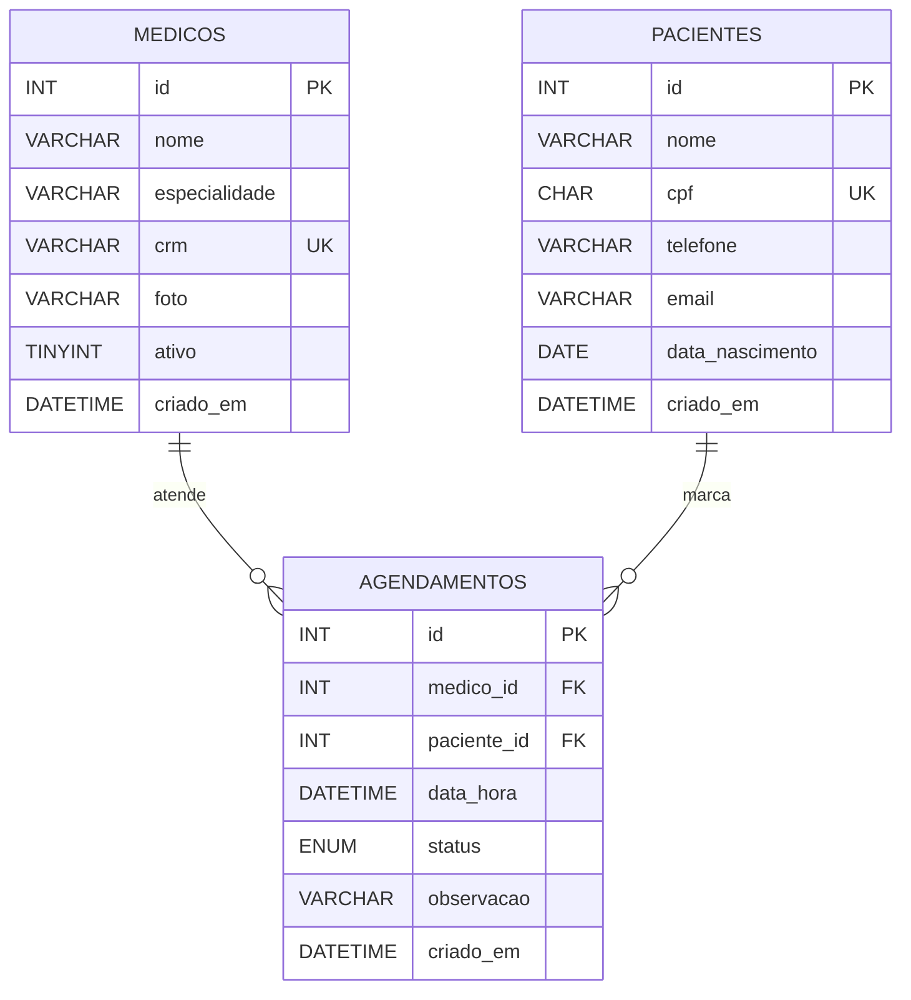

# Clínica Vida+ — Sistema de Agendamento de Consultas

Projeto Integrador (2ª unidade) da disciplina **Tecnologias Web**.

Site da clínica com agendamento de consultas online e uma área administrativa
para gerenciar médicos, pacientes e agendamentos. Feito com PHP puro + PDO e
MySQL/MariaDB, rodando no XAMPP.

---

## Como executar

### 1. Iniciar o Apache e o MySQL
1. Abra o **XAMPP Control Panel** (`C:\xampp\xampp-control.exe`).
2. Clique em **Start** na linha do **Apache** e na linha do **MySQL**.
3. Os dois nomes devem ficar com fundo verde.

### 2. Colocar o projeto na pasta do XAMPP
A pasta do projeto deve ficar em `C:\xampp\htdocs\Projeto-clinica-web`.

### 3. Importar o banco de dados

**Opção A — pelo phpMyAdmin**
1. Acesse `http://localhost/phpmyadmin`.
2. No menu superior, clique em **Importar** (se a janela estiver estreita, ele fica dentro de **Mais**).
3. Em "Arquivo a ser importado", escolha `banco/clinica.sql`.
4. Clique em **Importar** no fim da página.
5. O banco `clinica_vida` aparece no menu da esquerda com as tabelas `medicos`, `pacientes` e `agendamentos`.

**Opção B — pelo terminal**
```
C:\xampp\mysql\bin\mysql.exe -u root --default-character-set=utf8mb4 < banco\clinica.sql
```

> O script apaga e recria o banco `clinica_vida`. Reimportar volta os dados ao estado inicial.

### 4. Acessar no navegador
| Página | Endereço |
|---|---|
| Site público | `http://localhost/Projeto-clinica-web/` |
| Área administrativa | `http://localhost/Projeto-clinica-web/admin/` |

A área administrativa também pode ser aberta pelo botão **Área administrativa** no rodapé do site.

### 5. (Opcional) Rodar os testes automáticos
Com o Apache e o MySQL ligados:
```
C:\xampp\php\php.exe testes\executar_testes.php
```
São 52 testes de validação e regras de negócio. O script apaga os dados que cria.

### Credenciais do banco
Ficam em `config/conexao.php` (padrão do XAMPP: usuário `root`, sem senha).

---

## Funcionalidades

### Site público (`index.php`)
- Cards dos médicos carregados do banco (somente os ativos).
- Botão **Agendar** em cada card abre um formulário com o médico já selecionado.
- O paciente informa os próprios dados e a data/hora desejada.
- Se o CPF já estiver cadastrado, o paciente existente é reutilizado; senão, é criado.
- Envio sem recarregar a página (jQuery/AJAX), com mensagens de sucesso e erro.
- Máscaras de CPF e telefone; menu mobile funcional.

### Área administrativa
- **Médicos:** listar, cadastrar (com upload de foto), editar, excluir, ativar/desativar.
- **Pacientes:** listar com busca por nome ou CPF, cadastrar, editar, excluir.
- **Agendamentos:** listar com filtro por médico, data e status; cadastrar; editar (inclusive status); excluir.
- Painel inicial com totais.
- Confirmação antes de qualquer exclusão.

### Regras de negócio
- O mesmo médico não pode ter dois agendamentos ativos (agendado/confirmado) no mesmo horário.
- Não é aceito agendamento em data/hora no passado.
- Consulta futura não pode ter status "Realizado".
- CPF válido (formato + dígitos verificadores) e sem duplicata.
- E-mail válido; telefone com DDD (fixo ou celular).
- CRM único no formato `CRM/UF 123456`.
- Médico inativo não recebe novos agendamentos.
- Médico ou paciente com agendamentos não pode ser excluído (com mensagem explicando).

### Segurança
- **Prepared statements** em todas as consultas com dado externo (contra SQL injection).
- **`htmlspecialchars()`** (função `e()`) em todo dado exibido (contra XSS).
- **Validação no servidor** de todos os campos, mesmo com validação no HTML/JS.
- Erros técnicos nunca aparecem para o usuário: são registrados com `error_log()` em `logs/erros.log`.
- Credenciais em arquivo separado (`config/conexao.php`).
- Upload de foto valida o tipo real do arquivo e o tamanho (máx. 2 MB).
- Agendamento pelo site usa transação e trava (`FOR UPDATE`) para evitar dois pacientes no mesmo horário.

---

## Tecnologias
- **HTML5, CSS3** (fonte Poppins) e **JavaScript** com **jQuery 3.7.1**
- **PHP 8** (puro, sem frameworks) com **PDO**
- **MySQL / MariaDB** (InnoDB, utf8mb4)
- **XAMPP** (Apache + MySQL + phpMyAdmin)
- **Git** para versionamento

---

## Banco de dados (DER)



**Relacionamentos**
- Um **médico** pode ter vários **agendamentos** (1:N).
- Um **paciente** pode ter vários **agendamentos** (1:N).
- Assim, `agendamentos` liga médicos e pacientes (N:N com dados próprios: data/hora, status, observação).
- As FKs usam `ON DELETE RESTRICT`: o próprio banco impede excluir médico ou paciente com agendamentos.

---

## Estrutura de pastas
```
index.php                 Site público
agendar.php               Recebe o agendamento do site (responde JSON)
admin/index.php           Painel da área administrativa
config/conexao.php        Credenciais e conexão PDO
includes/
  funcoes.php             Validações, helpers, mensagens, regras de negócio
  cabecalho.php           Topo das páginas do admin
  rodape.php              Rodapé das páginas do admin
medicos/                  listar, cadastrar, editar, excluir (+ _formulario)
pacientes/                listar, cadastrar, editar, excluir (+ _formulario)
agendamentos/             listar, cadastrar, editar, excluir (+ _formulario)
css/                      style.css, header.css, admin.css
js/script.js              Menu mobile, modal, máscaras, envio AJAX
src/                      Imagens (logo, fundo, fotos dos médicos)
banco/clinica.sql         Estrutura + relacionamentos + dados de teste
testes/executar_testes.php Testes automáticos (somente terminal)
logs/                     Log de erros (bloqueado para o navegador)
docs/apresentacao.md      Rascunho da apresentação
```
