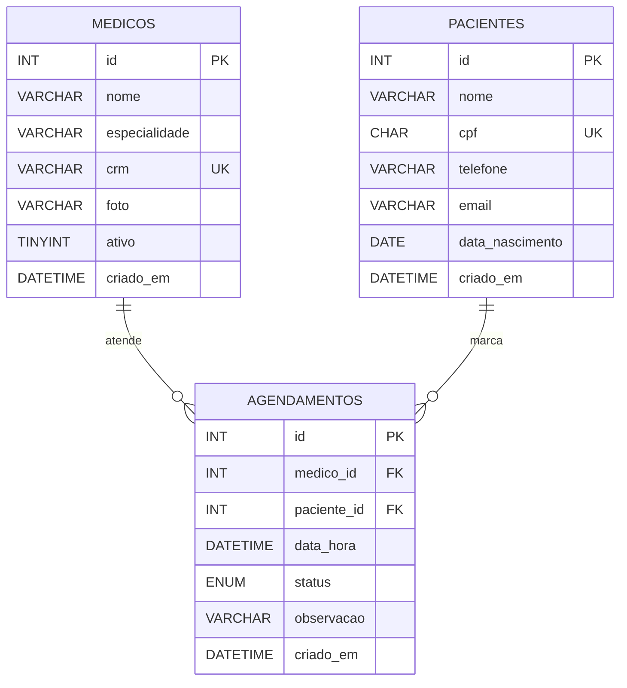

# Clínica Vida+
### Sistema de Agendamento de Consultas
Projeto Integrador — Tecnologias Web — 2ª unidade

---

## 1. O problema original

A Clínica Vida+ tinha apenas um site institucional estático (HTML, CSS e jQuery):
uma página com menu, imagem de destaque, os cards de três médicos e o rodapé de contato.

**Problema central:** os pacientes não conseguiam agendar consultas pelo site.

Problemas encontrados no front-end da 1ª unidade:
- Os botões "Agendar Horário" e "Agendar com o Dr." não faziam nada.
- O `script.js` estava vazio: os botões chamavam uma função `selecionarMedico()` que não existia.
- Não havia formulário de agendamento.
- Os médicos estavam fixos no HTML (para mudar, era preciso editar o código).
- O `id="nav_list"` aparecia duas vezes na página (HTML inválido).
- O menu mobile existia no HTML, mas não abria nem fechava.

---

## 2. Evolução na 2ª unidade

| Antes (1ª unidade) | Depois (2ª unidade) |
|---|---|
| Página estática `index.html` | Página dinâmica `index.php` |
| Médicos fixos no HTML | Médicos carregados do banco de dados |
| Botões sem função | Botão abre formulário com o médico já selecionado |
| Sem armazenamento de dados | Banco MySQL com 3 tabelas relacionadas |
| Sem gestão | Área administrativa com CRUD completo |
| Menu mobile parado | Menu mobile abre e fecha |
| `id` duplicado | Corrigido para `class` |

O visual original foi mantido (fonte Poppins, cores verde/creme, cards).

---

## 3. Funcionalidades

### Site público
- Lista de médicos ativos vinda do banco.
- Agendamento online em janela (modal), sem recarregar a página.
- Se o paciente já tem cadastro (mesmo CPF), o sistema reaproveita.
- Mensagens claras de sucesso e de erro.
- Máscaras de CPF e telefone.

### Área administrativa
- **Médicos:** cadastrar (com foto), listar, editar, excluir, ativar/desativar.
- **Pacientes:** cadastrar, listar com busca por nome/CPF, editar, excluir.
- **Agendamentos:** cadastrar, listar com filtros (médico, data, status), editar status, excluir.
- Confirmação antes de excluir.

### Regras de negócio
- Médico não pode ter duas consultas ativas no mesmo horário.
- Não é possível agendar no passado.
- CPF validado pelos dígitos verificadores e sem duplicidade.
- E-mail válido e telefone com DDD.
- Médico/paciente com agendamentos não pode ser excluído.
- Médico inativo não recebe novos agendamentos.

### Segurança
- Prepared statements (PDO) contra SQL injection.
- `htmlspecialchars()` contra XSS.
- Validação no servidor, além da validação no navegador.
- Erros técnicos registrados em log, nunca mostrados ao usuário.
- Credenciais em arquivo separado.

### Qualidade
- 52 testes automáticos de validação e regras de negócio, todos passando.

---

## 4. Tecnologias

- **Front-end:** HTML5, CSS3, JavaScript, jQuery
- **Back-end:** PHP 8 puro (sem frameworks) com PDO
- **Banco de dados:** MySQL / MariaDB
- **Servidor local:** XAMPP (Apache + MySQL + phpMyAdmin)
- **Versionamento:** Git

---

## 5. Entidades e relacionamentos

**medicos** — id (PK), nome, especialidade, crm (único), foto, ativo, criado_em

**pacientes** — id (PK), nome, cpf (único), telefone, email, data_nascimento, criado_em

**agendamentos** — id (PK), medico_id (FK), paciente_id (FK), data_hora, status, observacao, criado_em

- Status possíveis: agendado, confirmado, cancelado, realizado.

**Relacionamentos**
- Um médico possui vários agendamentos (1:N).
- Um paciente possui vários agendamentos (1:N).
- A tabela `agendamentos` liga médicos e pacientes (relacionamento N:N com dados próprios).
- As chaves estrangeiras usam `ON DELETE RESTRICT`, protegendo os dados no próprio banco.

---

## 6. Como executar

1. Abrir o **XAMPP Control Panel** e clicar em **Start** no **Apache** e no **MySQL**.
2. Colocar a pasta do projeto em `C:\xampp\htdocs\Projeto-clinica-web`.
3. Acessar `http://localhost/phpmyadmin`, clicar em **Importar**, escolher o arquivo
   `banco/clinica.sql` e clicar em **Importar**.
4. Abrir o site em `http://localhost/Projeto-clinica-web/`.
5. Abrir a área administrativa em `http://localhost/Projeto-clinica-web/admin/`
   (ou pelo botão "Área administrativa" no rodapé do site).

---

## 7. Roteiro sugerido para a demonstração

1. Mostrar o site e os cards vindos do banco.
2. Clicar em "Agendar com a Dra." e mostrar o médico já selecionado.
3. Tentar enviar vazio e com CPF inválido (mensagens de erro).
4. Tentar o horário já ocupado (regra de negócio).
5. Fazer um agendamento válido.
6. Abrir a área administrativa e mostrar o novo agendamento na lista.
7. Mudar o status para "Confirmado".
8. Tentar excluir um médico com agendamentos (bloqueado com explicação).
9. Mostrar no phpMyAdmin as tabelas e as chaves estrangeiras.
10. (Opcional) Rodar os testes automáticos no terminal.
